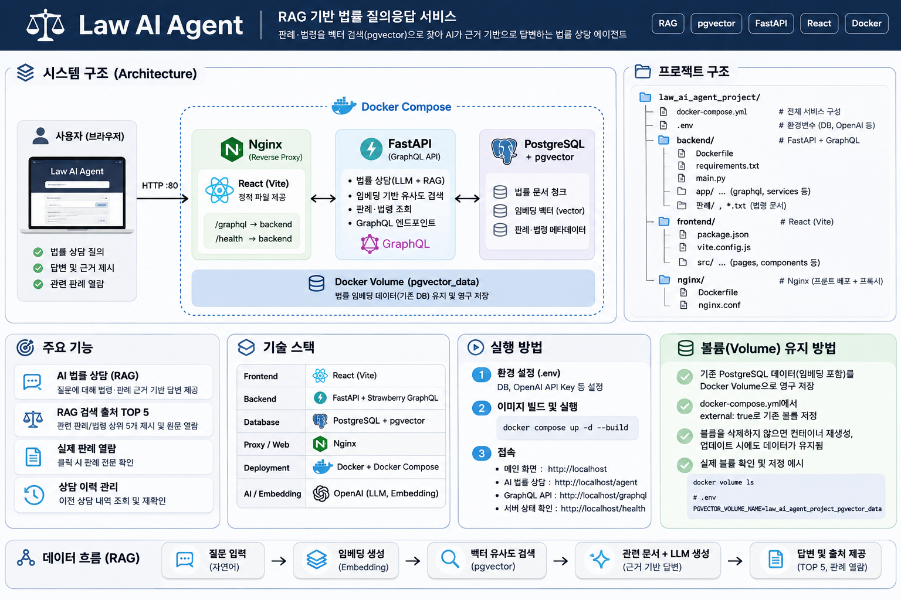
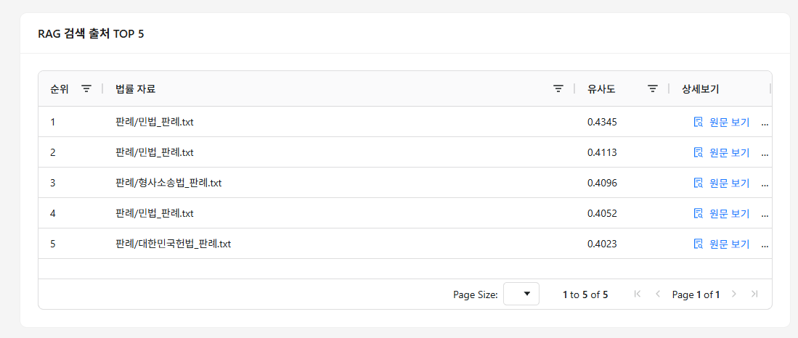
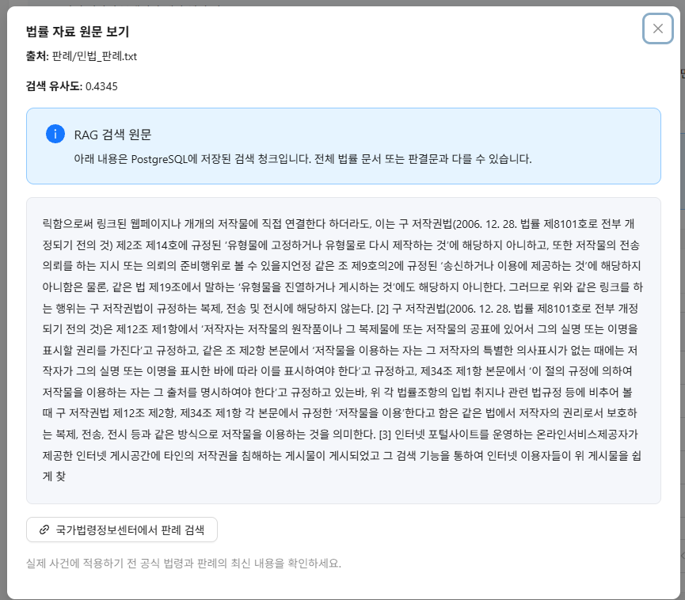

# ⚖️ Law AI Agent

**React + FastAPI + GraphQL + PostgreSQL(pgvector) + OpenAI 기반 법률 정보 검색·상담 RAG 프로젝트**

사용자의 자연어 법률 질문을 임베딩하여 저장된 법령·판례 문서에서 관련 구간을 검색하고, 검색 근거를 바탕으로 LLM이 답변합니다. 검색 출처 TOP 5와 저장된 원문 청크를 확인할 수 있습니다.

> ⚠️ 이 프로젝트는 법률 정보 탐색을 위한 데모이며 변호사의 법률 자문을 대체하지 않습니다. 저장된 판례 청크는 판결문 전체가 아닐 수 있으며, 공식 판례 직접 링크는 검증된 사건번호·URL 메타데이터가 있을 때만 제공할 수 있습니다.

## 🏗️ 시스템 아키텍처



- **Nginx**: React(Vite) 정적 파일 제공 및 `/graphql`, `/health`를 FastAPI로 리버스 프록시
- **FastAPI + Strawberry GraphQL**: `consultLaw` Mutation, RAG 오케스트레이션
- **OpenAI**: 질문 임베딩 및 검색 근거 기반 답변 생성
- **PostgreSQL + pgvector**: 법령·판례 청크 및 임베딩 벡터 영속 저장
- **Docker Compose**: Nginx / Backend / DB 서비스와 내부 네트워크 관리

## 🖥️ 실제 실행 화면 (Screenshots)

아래 화면은 Docker로 실행한 **Law AI Agent의 실제 브라우저 캡처**입니다. 상담 질문부터 AI 답변, 검색 근거 TOP 5, 저장된 법률 문서 청크 열람까지의 흐름을 보여줍니다.

### 1. AI 법률 상담 입력


- 왼쪽 사이드바: **AI 법률 상담 / 상담 내역 / 법률 자료** 메뉴
- 상단 상태 표시: **GraphQL 연결**
- 상담 질문 입력 및 개인정보 입력 주의 안내
- 화면의 예시 질문: `ai로 만든 글의 저작권`

### 2. AI 법률 상담 결과


- GraphQL `consultLaw` 요청 결과가 `SUCCESS`로 표시됩니다.
- 답변은 상담 내용 요약, 관련 법률 및 근거, 가능한 대응 방법, 추가 확인 사항, 전문가 상담 필요 여부로 구성되어 있습니다.
- **주의:** 화면에 표시된 법률·판례 언급은 LLM 생성 결과입니다. 특정 사건번호나 법률 해석의 정확성이 검증되었다는 의미는 아닙니다.

### 3. RAG 검색 출처 TOP 5



- **AG Grid**로 순위, 법률 자료 파일명, 코사인 유사도를 표시합니다.
- 캡처에서는 `판례/민법_판례.txt`, `판례/형사소송법_판례.txt`, `판례/대한민국헌법_판례.txt` 등의 파일에서 검색된 청크가 표시됩니다.
- **동일 파일이 여러 번 나타날 수 있습니다.** 문서별 1건이 아니라 *청크 단위 TOP 5*를 검색하기 때문입니다.
- 유사도는 검색 순위를 위한 수치이며 **법적 타당성이나 답변 정확도의 점수는 아닙니다.**

### 4. 검색 원문 상세보기 (Modal)



- 검색 결과의 **원문 보기**를 클릭하면 Ant Design Modal이 열립니다.
- 출처 파일명, 검색 유사도, PostgreSQL에 저장된 **실제 검색 청크**를 확인할 수 있습니다.
- **국가법령정보센터에서 판례 검색** 버튼은 공식 검색 페이지를 여는 기능이며, 현재는 선택된 특정 판결문으로 직접 이동하는 링크가 아닙니다.
- 전체 판결문 직접 열람을 위해서는 `case_number`, `official_url`, `document_id` 등 검증된 메타데이터 연결이 추가로 필요합니다.

## ✨ 주요 기능

| 기능 | 설명 |
| --- | --- |
| 법률 상담 | 자연어 질문에 대한 검색 근거 기반 AI 답변 |
| RAG 검색 | 질문 임베딩과 pgvector 코사인 거리로 유사 청크 TOP 5 조회 |
| 검색 출처 | 출처 파일명, 유사도, 검색된 원문 청크 표시 |
| 원문 확인 | AG Grid 행 클릭 시 Modal에서 DB에 저장된 청크 확인 |
| GraphQL API | Strawberry GraphQL의 `consultLaw`, `health` |
| 컨테이너 배포 | Nginx + FastAPI + PostgreSQL을 Docker Compose로 실행 |

## 🧰 기술 스택

| 영역 | 기술 |
| --- | --- |
| Frontend | React, Vite, Ant Design, AG Grid, styled-components |
| Backend | Python, FastAPI, Strawberry GraphQL |
| RAG | OpenAI Embedding, LLM, pgvector |
| Database | PostgreSQL 16 + pgvector |
| Infra | Docker, Docker Compose, Nginx |

## 📂 프로젝트 구조

```text
law_ai_agent_project/
├── .env                         # 로컬 비밀 설정 (Git에 올리지 않음)
├── docker-compose.yml           # nginx, backend, db
├── backend/
│   ├── Dockerfile
│   ├── requirements.txt
│   ├── main.py                   # FastAPI 및 /graphql
│   ├── ingest.py                 # 법률 문서 임베딩 적재 (수동 실행)
│   ├── *.txt                     # 법령 원본
│   ├── 판례/                     # 판례 원본
│   └── app/
│       ├── database.py
│       ├── graphql/              # schema, resolver, types, inputs
│       ├── models/
│       ├── repositories/         # pgvector 유사도 검색
│       ├── services/             # Agent, Embedding, LLM
│       └── prompts/              # 법률 응답 정책
├── frontend/
│   ├── package.json
│   ├── vite.config.js
│   └── src/
│       ├── graphql/              # GraphQL 요청
│       ├── pages/                # 상담 화면 및 이력/문서 메뉴
│       ├── components/           # 상담폼/답변/출처 그리드
│       └── styles/
└── nginx/
    ├── Dockerfile               # Vite 빌드 + Nginx
    └── nginx.conf                # 정적 파일 및 리버스 프록시
```

## 🔄 RAG 처리 흐름

```text
사용자 질문 → React → POST /graphql → FastAPI
    → OpenAI 질문 임베딩
    → PostgreSQL(pgvector) 코사인 유사도 TOP 5 검색
    → 검색된 법률 문맥 + 질문 → OpenAI LLM
    → GraphQL 응답(answer, status, sources)
    → React 답변 + AG Grid 출처 + 원문 Modal
```

## 🚀 Docker 배포

### 1. 기존 DB 볼륨 이름 확인

```powershell
docker volume ls
# 기존 compose 파일이 있다면 볼륨 연결 확인
docker compose config
```

**주의:** 아래 `.env`의 `PGVECTOR_VOLUME_NAME`은 실제 사용 중인 볼륨 이름으로 지정해야 합니다. 볼륨 이름을 잘못 지정하면 기존 데이터가 보이지 않습니다.

### 2. `.env` 구성

```dotenv
POSTGRES_DB=law_rag
POSTGRES_USER=law_user
POSTGRES_PASSWORD=기존_DB_비밀번호
PGVECTOR_VOLUME_NAME=실제_기존_볼륨_이름
DATABASE_URL=postgresql://law_user:URL인코딩된_기존비밀번호@db:5432/law_rag
OPENAI_API_KEY=본인_API_키
EMBEDDING_MODEL=text-embedding-3-small
CHAT_MODEL=gpt-4.1-mini
```

> 이미 초기화된 PostgreSQL 볼륨의 DB 사용자 비밀번호는 `.env` 변경만으로 바뀌지 않습니다. 기존에 사용하던 비밀번호를 사용하세요.

### 3. `docker-compose.yml`의 DB 볼륨 설정

```yaml
services:
  db:
    image: pgvector/pgvector:pg16
    volumes:
      - pgvector_data:/var/lib/postgresql/data
    # 기존 서비스의 나머지 설정은 유지

volumes:
  pgvector_data:
    external: true
    name: ${PGVECTOR_VOLUME_NAME}
```

위 예시는 **볼륨 연결에 필요한 부분만** 보여줍니다. 실제 Compose 파일에는 backend, nginx, 네트워크, 환경변수 설정이 함께 있어야 합니다. `external: true`는 지정한 볼륨이 없으면 실행을 실패시키므로, 실수로 빈 DB를 만드는 일을 방지하는 데 유용합니다.

### 4. 빌드 및 실행

```powershell
docker compose config --quiet
docker compose up -d --build
docker compose ps
docker compose logs --tail=100 backend
```

### 5. 접속 주소

| 화면/API | URL |
| --- | --- |
| React 메인 | http://localhost |
| AI 상담 | http://localhost/agent |
| GraphQL | http://localhost/graphql |
| 상태 확인 | http://localhost/health |

> 포트 80이 이미 사용 중이면 Compose의 nginx 포트 매핑을 변경하세요.

### 6. GraphQL 헬스 체크

```powershell
$body = @{ query = '{ health }' } | ConvertTo-Json
Invoke-RestMethod -Uri 'http://localhost/graphql' -Method Post -ContentType 'application/json' -Body $body
```

## 💾 PostgreSQL pgvector 데이터 보존

### 원칙

1. PostgreSQL 데이터를 컨테이너 내부가 아닌 **Docker named volume**에 저장합니다.
2. 기존 볼륨을 정확한 이름으로 연결하고, `external: true`로 관리합니다.
3. **`docker compose down -v` 또는 `docker volume rm`을 실행하지 않습니다.**
4. `ingest.py`를 배포 시작 명령에 넣지 않습니다. 기존 데이터를 중복 적재할 수 있습니다.
5. 볼륨 유지와 별개로 **정기적인 논리 백업(`pg_dump`)**을 보관합니다.

### 기존 데이터 확인

```powershell
docker compose exec db psql -U law_user -d law_rag -c 'SELECT COUNT(*) FROM law_chunks;'
docker volume inspect $env:PGVECTOR_VOLUME_NAME
```

PowerShell에서 `.env` 값은 자동으로 `$env:PGVECTOR_VOLUME_NAME`에 들어가지 않습니다. 환경변수를 별도로 설정하거나 `docker volume inspect 실제_볼륨_이름`으로 실행하세요.

### 백업 (Windows PowerShell)

```powershell
New-Item -ItemType Directory -Force backups | Out-Null
# pg_dump 결과는 컨테이너 안에 생성하고, docker cp로 바이너리 안전하게 복사
docker compose exec -T db sh -c 'pg_dump -U "$POSTGRES_USER" -d "$POSTGRES_DB" -Fc -f /tmp/law_rag.dump'
$cid = docker compose ps -q db
docker cp "${cid}:/tmp/law_rag.dump" .\backups\law_rag.dump
docker compose exec -T db rm -f /tmp/law_rag.dump
```

> `backups/`는 `.gitignore`에 추가하고, DB 백업을 공개 GitHub 저장소에 업로드하지 마세요. 판례·법령 원문 등 데이터의 라이선스도 확인해야 합니다.

### 다른 PC로 이전

새 PC에서 동일한 PostgreSQL/pgvector 버전의 빈 DB를 준비한 뒤, 백업 파일을 복사하고 `pg_restore`로 복원합니다. **기존 데이터가 있는 DB에는 무작정 복원하지 마세요.** 복원 대상과 충돌 여부를 먼저 확인해야 합니다.

```powershell
$cid = docker compose ps -q db
docker cp .\backups\law_rag.dump "${cid}:/tmp/law_rag.dump"
docker compose exec db pg_restore -U law_user -d law_rag --no-owner /tmp/law_rag.dump
```

> 복원 시 대상 DB는 새로 준비한 빈 데이터베이스여야 하며, `vector` 확장을 설치할 수 있는 권한과 pgvector 이미지가 필요합니다. `pg_restore`에서 충돌이 나면 임의로 `--clean`을 추가하지 말고 대상 DB 상태를 먼저 확인하세요.

## 🔐 보안 및 유의사항

- `.env`, API 키, DB 백업, 개인정보가 포함된 문서를 GitHub에 올리지 않습니다.
- 운영 환경에서는 HTTPS, 인증/인가, 요청 제한, 로그 민감정보 마스킹을 추가해야 합니다.
- 검색된 청크의 출처와 유사도는 법적 정확성의 보증이 아닙니다.
- 공식 판례 원문 연결은 검증된 사건번호 및 URL 메타데이터가 확보된 경우에만 활성화합니다.

## 📄 라이선스 / 데이터 출처

애플리케이션 코드의 라이선스와 법령·판례 데이터의 이용 조건은 별도로 관리합니다. 법률 문서의 출처, 수집일, 이용 조건을 확인한 후 배포하세요.
